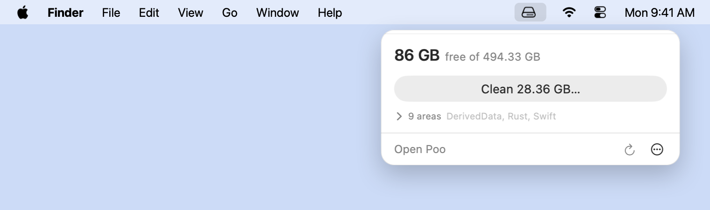
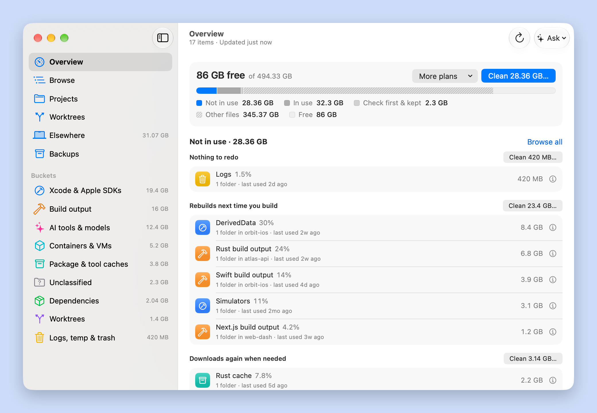
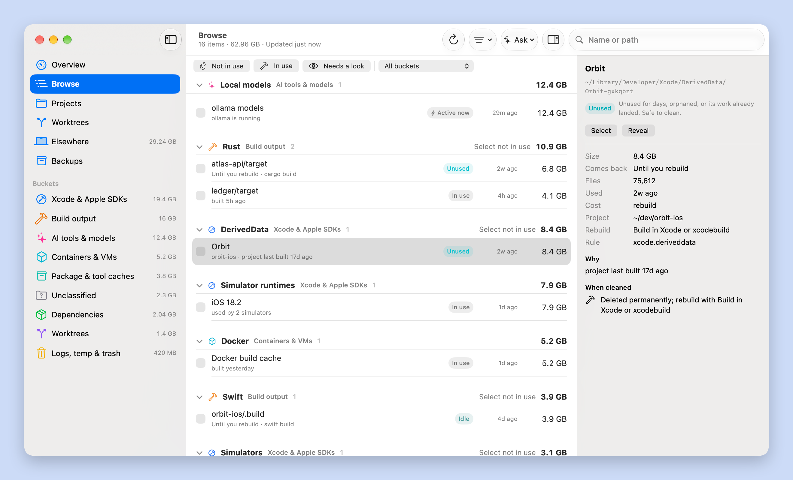
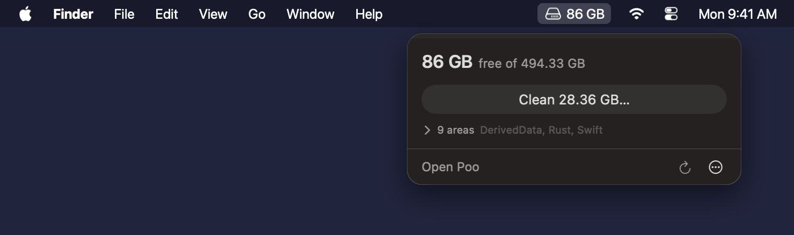
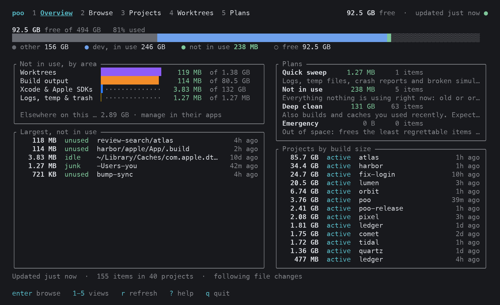
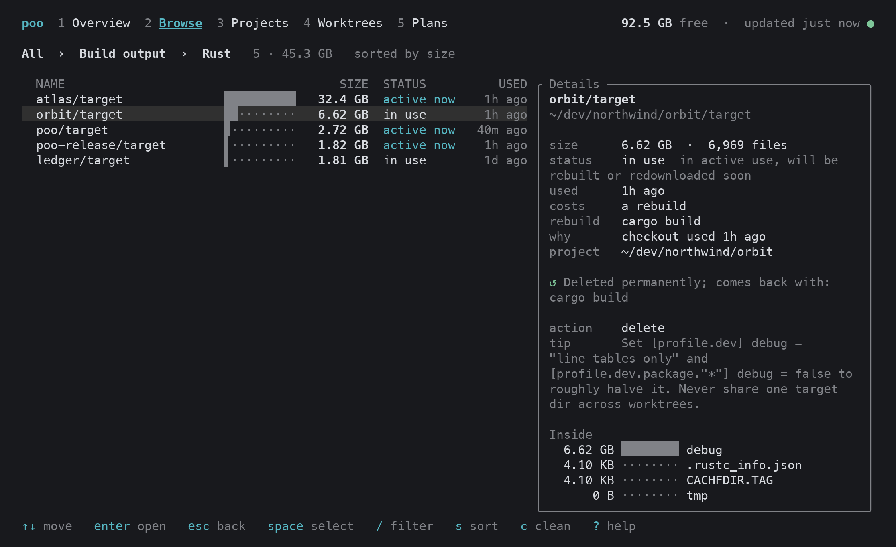
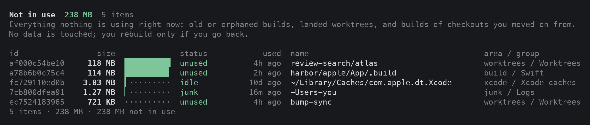

# poo

[](https://github.com/morajabi/poo/actions/workflows/ci.yml)
[](https://github.com/morajabi/poo/releases/latest)
[](https://github.com/morajabi/poo/releases/latest/download/Poo.app.zip)
[](LICENSE)

**Find and safely free the disk space your dev work eats.** A CLI, a macOS menu bar
app, and an MCP server plus skill so your coding agent can do it for you.

Most cleaners stop at global caches, so you clear things you rebuild two days later.
On a developer Mac, the real growth is elsewhere:

- every worktree (yours, Claude's, Codex's, Conductor's) gets its own Rust `target`,
  SwiftPM `.build` per package, Xcode DerivedData, `node_modules` and `dist`;
  that is 10–25 GB per feature, duplicated per checkout;
- agents pass `-derivedDataPath` and `CARGO_TARGET_DIR` into folders nobody cleans;
- merged worktrees, old simulators and runtimes, superseded toolchains and agent CLI
  versions pile up.

poo knows these workflows. It walks your dev folders and agent worktree homes, maps
DerivedData back to its checkout, checks each worktree for uncommitted work and merge
state, and gives every item a **tier** that says how much regret cleaning it causes.
It also covers the usual cleaner territory (app, browser and system caches, logs, temp,
installers, Docker, Homebrew) with safety rules learned from tools like Mole.

<p align="center">
  
  
</p>

| | |
|---|---|
|  |  |
|  |  |

The CLI has the same picture, as an interactive terminal UI (`poo`) and as plain output
for scripts and agents (JSON when piped):

<p align="center">
  
  
</p>
<p align="center">
  
  
</p>

## Install

```sh
curl -fsSL https://raw.githubusercontent.com/morajabi/poo/main/install.sh | sh
# with the menu bar app:
curl -fsSL https://raw.githubusercontent.com/morajabi/poo/main/install.sh | POO_APP=1 sh
```

Or download the latest release directly (these links always point at the newest one):

| | |
|---|---|
| **Poo.app** (macOS 15+, Apple silicon and Intel, CLI included) | [Poo.app.zip](https://github.com/morajabi/poo/releases/latest/download/Poo.app.zip) |
| CLI, macOS Apple silicon | [poo-aarch64-apple-darwin.tar.gz](https://github.com/morajabi/poo/releases/latest/download/poo-aarch64-apple-darwin.tar.gz) |
| CLI, macOS Intel | [poo-x86_64-apple-darwin.tar.gz](https://github.com/morajabi/poo/releases/latest/download/poo-x86_64-apple-darwin.tar.gz) |
| CLI, Linux x86_64 | [poo-x86_64-unknown-linux-gnu.tar.gz](https://github.com/morajabi/poo/releases/latest/download/poo-x86_64-unknown-linux-gnu.tar.gz) |
| CLI, Linux arm64 | [poo-aarch64-unknown-linux-gnu.tar.gz](https://github.com/morajabi/poo/releases/latest/download/poo-aarch64-unknown-linux-gnu.tar.gz) |
| Checksums | [SHA256SUMS](https://github.com/morajabi/poo/releases/latest/download/SHA256SUMS) |

The app and macOS binaries are signed with a Developer ID and notarized by Apple when
the release was built with signing secrets (the release notes and the workflow summary
say which). All releases: [github.com/morajabi/poo/releases](https://github.com/morajabi/poo/releases).

Then `poo setup` to pick your dev folders. Homebrew formula and cask are coming
(`packaging/homebrew`).

### Updates

- **CLI (install script):** once a day, when you run poo in a terminal, it checks for
  a new release in a detached background process and installs it (sha256-verified,
  atomic swap). It never slows a command and never prints when output is JSON or
  piped; CI (`CI=1`) and `POO_NO_UPDATE_CHECK=1` skip it. `poo config set updates.auto
  false` prints a one-line hint instead; `updates.check false` turns checks off.
  `poo update` updates now, `poo update --check` only looks.
- **Poo.app:** updates through [Sparkle](https://sparkle-project.org) from an
  EdDSA-signed `appcast.xml` (Poo > Check for Updates…, plus automatic checks and
  installs in Settings). The CLI inside the app updates with it, so `poo update`
  leaves that copy, and Homebrew installs, to their owner and says so.

## Tiers, plans and modes

| tier | meaning | cleaned by plans |
|---|---|---|
| junk | nothing to rebuild: logs, temp, crash reports, broken simulators | quick, not in use, deep, emergency |
| cold | unused for days, orphaned (project gone), or its worktree's commits already landed | not in use, deep, emergency |
| idle | nothing uses it now: builds of checkouts other than your 2 newest per repo, untouched for hours | not in use, deep, emergency |
| warm | in active use: recent, or an agent, editor or shell is open in that checkout | deep, emergency |
| hot | a build or the owning app is running, or touched in the last hour | never |
| review | needs a human look: unknown ignored folders, worktrees with uncommitted work | never |
| protected | data, Docker volumes, projects you protected | never |

Mark projects `active`, `stale` or `protected` (`poo projects set`) and plans follow. Tune
`scan.keep_recent_checkouts` and `scan.idle_hours` to how many checkouts you build at once.

Everything that is not risk-free carries a note. `--include-in-use` also cleans things in
use: used in the last hour, checkouts with an agent open, worktrees with uncommitted work
(stashed first, never including build output). `--dangerously-include-protected` also takes
running builds, data, kept projects and detached commits (saved to a `poo/` branch first).
Plans and schedules only ever clean safe items.

## Backups you can see

Before removing a worktree poo copies its small ignored files (`.env`, `Local.xcconfig`)
into a dated folder, stashes uncommitted work, and saves detached commits to a branch.
`poo backups` lists them, `restore` puts files back, `prune` removes them. A 2 GB budget and
a 90-day limit keep the folder from growing; both live in `[backup]` in `config.toml`.

## Agent hooks (opt-in)

`poo hooks install all` makes Claude Code and Codex clean a worktree's build output when an
agent finishes there and its work already landed in main. Nothing is installed by default.

## Routine cleanups

```sh
poo schedule add nightly    # 03:30 every night: clean what nothing is using
poo schedule add guard      # low-disk guard: below 20 GB free, clean what's not in use until 50 GB
poo schedule ls
```

A launchd agent wakes poo every 15 minutes; due schedules rescan first, respect bucket and
tag filters, notify you, and log to `poo schedule log`.

## Fast, current numbers

The first scan walks everything (5-20 s with a warm disk cache). After that poo keeps an
index in `~/.local/state/poo/index.json` and reads the macOS file-change journal
(FSEvents) to see which folders changed since the last scan. Only those branches are
measured again; big folders remember their sizes, so a change deep inside a 20 GB build
folder costs a fraction of a second. Docker, Homebrew and simulator runtimes are asked again
every 15 minutes, and a full walk still happens once a day or whenever the journal lost
events, rules or roots changed.

- Commands that read (`poo`, `ls`, `plan`, MCP tools) reuse a report from the last
  `scan.fresh_seconds` (20 s), else update it from the journal first.
- `poo scan` updates now; `poo scan --full` walks everything.
- `poo watch` streams changes and keeps `report.json` current while something is looking
  (the app runs it while its window or menu is open). `POO_TRACE=1` prints timings.

## CLI

```
poo                         interactive terminal UI (a plain overview when piped or with --text)
poo scan [--full]           update the report (incremental unless --full)
poo watch                   keep the report current as files change
poo ls [bucket] [--tier cold] [--project PATH] [--min 1G] [-q text]
poo show <id|path>          why it is there, what it costs to rebuild, what is inside
poo plan stale              preview a plan (quick, stale, deep, emergency)
poo clean <id>... | --plan stale [--dry-run] [--yes]
poo free 30G                least-regret items until 30 GB are free
poo growth [--since 7d]     what grew, and when the disk fills at this rate
poo projects | poo worktrees
poo buckets | poo rules | poo mods | poo roots | poo config
poo suggest                 big folders no rule explains yet, with draft rules
poo mods lint | submit      check a rule, then share it as a pull request
poo catalog                 everything poo knows
poo rules explain <path>    which rule matches and why
poo schedule | poo backups | poo history | poo update
```

```
$ poo plan stale --text
Not in use  238 MB  5 items
Everything nothing is using right now: old or orphaned builds, landed worktrees, and builds of checkouts you moved on from. No data is touched; you rebuild only if you go back.

id                 size              status            used  name                                  area / group
af000c54be10     118 MB  ██████████  unused          4h ago  review-search/atlas                   worktrees / Worktrees
a78b6b0c75c4     114 MB  █████████▋  unused          2h ago  harbor/apple/App/.build               build / Swift
fc729110ed0b    3.83 MB  ▍·········  idle           10d ago  ~/Library/Caches/com.apple.dt.Xcode   xcode / Xcode caches
7cb800dfea91    1.27 MB  ▏·········  junk           16m ago  -Users-you                            junk / Logs
ec7524183965     721 KB  ··········  unused          4h ago  bump-sync                             worktrees / Worktrees
5 items · 238 MB · 238 MB not in use
```

Output is JSON when piped (`--text` forces tables). Errors are
`{"error":{"kind","message","hint"}}` with stable exit codes: 2 usage, 3 not found,
5 needs approval, 6 partial failure, 7 update failed, 8 invalid mods.

## For coding agents

```sh
poo integration install all    # skill + MCP for Claude Code, Codex, Cursor, OpenCode, Gemini, Windsurf
npx skills add morajabi/poo --skill poo -g   # skill only, via the open skills CLI
```

The MCP server (`poo mcp`) exposes `overview`, `list_items`, `inspect`, `plan`,
`clean` (dry run by default), `projects`, `catalog`, `explain_path`, `configure`,
`setup_brief` and `history`. Agents may clean up to the tier you allow
(`poo config set agents.auto_clean_max_tier cold`); anything above needs your approval.

Ask your agent: *"Set up poo for me: run `poo setup --agent` and configure it for my
workflows."* The brief gives it your disk, projects, duplication across worktrees,
everything poo knows, and the questions worth asking you.

## Mods

Everything poo knows is a built-in mod written in the same TOML format you can use:
about 635 rules, 96 project stacks and 12 agent worktree homes. It covers

- **Apple:** DerivedData (also custom `-derivedDataPath` folders), simulators and
  runtimes, device support, previews, SwiftPM, Swift SDKs, CocoaPods, Carthage, Tuist.
- **JS:** npm, pnpm, Yarn, Bun, Deno, Next, Nuxt, SvelteKit, Astro, Vite, Turbo, Nx,
  Expo and React Native, Electron and CDK output, Playwright, Cypress, Selenium, Prisma.
- **Python:** pip, uv, Poetry, PDM, Hatch, pipx, conda, pixi, pyenv, tox, nox, mypy,
  ruff, pytest, Jupyter, MkDocs and Sphinx output, Hugging Face and torch models.
- **Systems and JVM:** Rust, Go, Zig, C/C++ (CMake, Meson, vcpkg, Conan, ccache),
  Bazel, Buck2, Pants, Nix, Gradle, Maven, sbt, Kotlin, Android SDK and emulators.
- **More languages:** Ruby and Rails, PHP and Laravel, Elixir, Erlang, Gleam, Haskell,
  OCaml, Lean, D, Racket, Nim, Crystal, Julia, R, Perl, Lua, .NET, Flutter and Dart,
  Solidity, embedded (PlatformIO, Arduino, ESP-IDF) and Emscripten.
- **Infra:** Docker, OrbStack, Colima, Podman, Lima, UTM, Terraform, Terragrunt, Helm,
  Pulumi and cloud CLIs.
- **AI:** Claude Code, Codex, Cursor, Windsurf, Zed, Copilot, Gemini, OpenCode, Aider,
  Cline and friends, Ollama, LM Studio and other local model stores.
- **macOS:** app, browser and Electron caches, logs, crash reports, installers, app
  leftovers and the Trash. Locations macOS protects (browser profiles, Safari, Mail,
  device backups) are read only when poo has Full Disk Access.

Generic folder names (`dist`, `build`, `out`, `vendor`, `site`) only count when git
ignores them. Buckets, plans, stacks, worktree homes and guards are mod data too. Add rules,
override any field, disable rules, add buckets, write providers or guards in any
language: see [docs/mods.md](docs/mods.md) or `poo mods docs`.

### Share a rule

Your Mac has folders ours never sees. `poo suggest` lists big folders no rule explains and
drafts a rule for each; `poo mods submit <mod>` lints it, removes your home path and your
user, machine and project names, shows you exactly what would be sent, and only then opens
a pull request through `gh` (or prints prefilled GitHub links). See
[CONTRIBUTING.md](CONTRIBUTING.md).

## Safety

poo never deletes outside your home and temp folders (or a rule's declared system
path), never symlinks or anything under `.ssh`, `.gnupg`, Keychains or iCloud, never a
project artifact that contains `.git`, and removes worktrees only through
`git worktree remove`, which refuses uncommitted changes and keeps the branch. Right
before deleting, it re-checks the item against its rule and skips projects where a
build tool or coding agent is running. Deletes rename into a graveyard first, so a
folder disappears atomically. Every clean is logged (`poo history`).

## Build from source

```sh
cargo build --release                 # CLI
./scripts/build-app.sh                # dist/Poo.app with the CLI bundled
```

## Releases

Every push to `main` whose `ci` workflow passes (Rust tests on macOS and Linux,
`mods validate`, `swift build` and `swift test` for the app) is released by
`.github/workflows/release.yml`. Put `[skip release]` in the commit message to skip
one; run the workflow by hand to release `main` again.

**Versioning:** `major.minor` come from `Cargo.toml`; the patch counts up from the
highest `v<major>.<minor>.*` tag (the first release uses `Cargo.toml`'s patch). The
version is stamped into the build (`scripts/stamp-version.sh`), never committed; the
release tag `vX.Y.Z` on the commit records it. Bump `major.minor` in `Cargo.toml` to
start a new series.

**Assets:** `poo-<target>.tar.gz` for macOS and Linux (arm64, x86_64), a universal
`Poo.app.zip`, `latest.json` (read by `install.sh`, `poo update`), `appcast.xml`
(read by Sparkle) and `SHA256SUMS`.

### Secrets

Set these in GitHub under Settings > Secrets and variables > Actions. Without them a
release still publishes, with less in it.

| Secret | What | Without it |
|---|---|---|
| `SPARKLE_PRIVATE_KEY` | Sparkle EdDSA private key (base64 seed, below) | No `appcast.xml`; the app in that release has no `SUPublicEDKey` and never updates itself |
| `MACOS_CERT_P12` | Developer ID Application certificate + key, `.p12`, base64 | App is ad-hoc signed |
| `MACOS_CERT_PASSWORD` | Password of that `.p12` | |
| `MACOS_SIGN_IDENTITY` | e.g. `Developer ID Application: Your Name (TEAMID)` | |
| `APPLE_ID` | Apple ID email used for notarization | Not notarized |
| `APPLE_TEAM_ID` | 10-character team id | |
| `APPLE_APP_PASSWORD` | App-specific password from appleid.apple.com | |
| `APPLE_API_KEY_P8` / `APPLE_API_KEY_ID` / `APPLE_API_ISSUER` | Instead of the three above: an App Store Connect API key (`.p8`, base64), its key id and issuer id | |

**Sparkle key**, once. `generate_keys` comes with Sparkle (after `swift build` in
`app/`):

```sh
swift package --package-path app resolve
app/.build/artifacts/sparkle/Sparkle/bin/generate_keys            # creates the key in your login keychain, prints the public key
app/.build/artifacts/sparkle/Sparkle/bin/generate_keys -x sparkle-private-key.txt
gh secret set SPARKLE_PRIVATE_KEY < sparkle-private-key.txt
rm sparkle-private-key.txt
```

The private key lives in your login keychain ("Private key for signing Sparkle
updates"); back it up, because losing it means shipped apps can only update again
through a Developer ID signed build. The public key does not need to be stored
anywhere: the release derives it from the secret (`scripts/sparkle.sh pubkey`).

**Developer ID signing and notarization** (optional; signs Poo.app, its bundled CLI
and the macOS CLI binaries, notarizes both and staples the app):

1. In Keychain Access > login > My Certificates, right-click "Developer ID Application:
   Your Name (TEAMID)" and Export as `cert.p12` with a password. (No certificate yet:
   Xcode > Settings > Accounts > Manage Certificates > + > Developer ID Application.)
2. Notarization credentials, either:
   - an app-specific password: appleid.apple.com > Sign-In and Security > App-Specific
     Passwords, plus your Apple ID email and team id; or
   - an App Store Connect API key: App Store Connect > Users and Access > Integrations >
     Team Keys, role Developer; download `AuthKey_<id>.p8` and note the key id and issuer id.
3. Store them:

```sh
base64 -i cert.p12 | gh secret set MACOS_CERT_P12
gh secret set MACOS_CERT_PASSWORD             # the export password
gh secret set MACOS_SIGN_IDENTITY --body "Developer ID Application: Your Name (TEAMID)"
# app-specific password route
gh secret set APPLE_ID --body "you@example.com"
gh secret set APPLE_TEAM_ID --body "TEAMID"
gh secret set APPLE_APP_PASSWORD             # xxxx-xxxx-xxxx-xxxx
# or the API key route
base64 -i AuthKey_ABC123.p8 | gh secret set APPLE_API_KEY_P8
gh secret set APPLE_API_KEY_ID --body "ABC123"
gh secret set APPLE_API_ISSUER --body "<issuer uuid>"
rm cert.p12
```

Locally, `SIGN_IDENTITY="Developer ID Application: ..." ./scripts/build-app.sh` signs,
and `NOTARY_PROFILE=<profile> scripts/notarize.sh dist/Poo.app.zip` notarizes with a
profile saved by `xcrun notarytool store-credentials`.

**Ad-hoc signed apps and Sparkle.** Sparkle 2 accepts an update when its EdDSA
signature verifies against the running app's key and the new app's code signature is
valid; it does not require the old and new designated requirements to match when
EdDSA passes. So ad-hoc builds update each other, and moving to Developer ID later is
a normal update. What ad-hoc costs: Gatekeeper blocks the first launch of a download
(right-click > Open, or `xattr -dr com.apple.quarantine /Applications/Poo.app`), and
macOS ties privacy grants such as Full Disk Access to the exact build, so each ad-hoc
update asks for them again. Ad-hoc builds are signed without the hardened runtime,
which would refuse to load the ad-hoc signed Sparkle framework.

MIT licensed.
