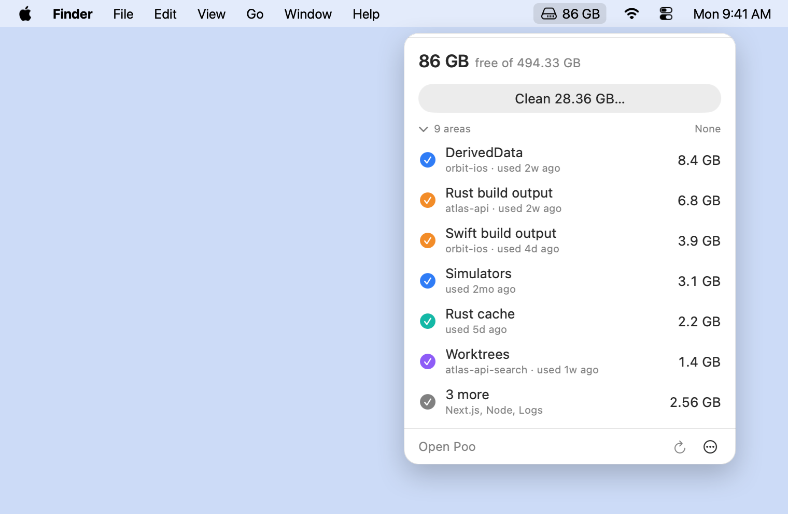
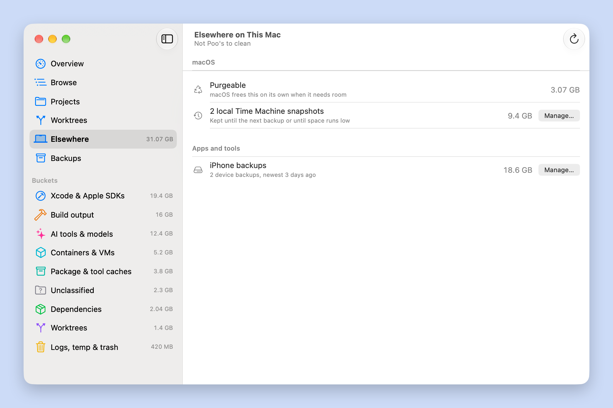
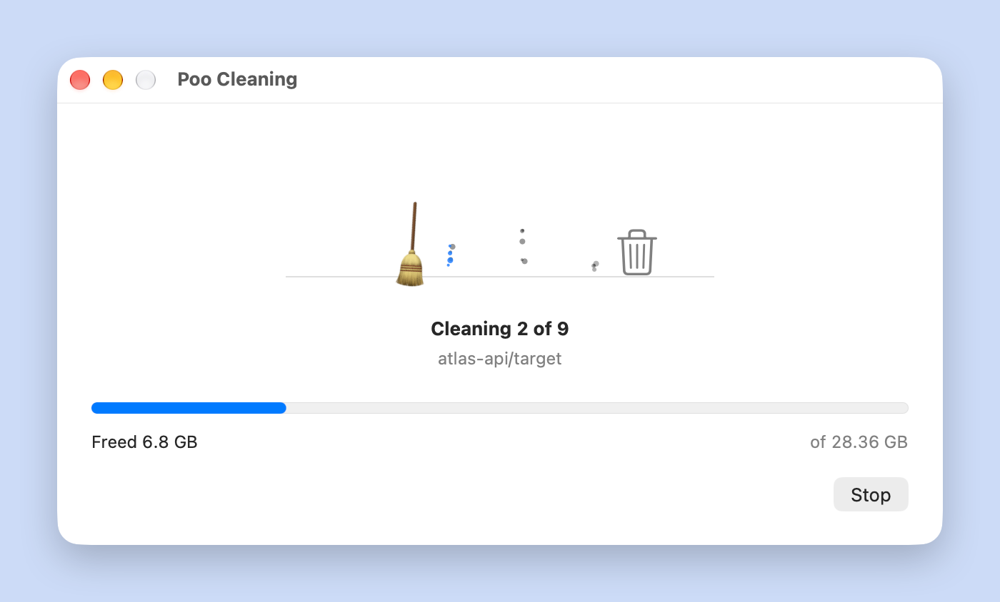
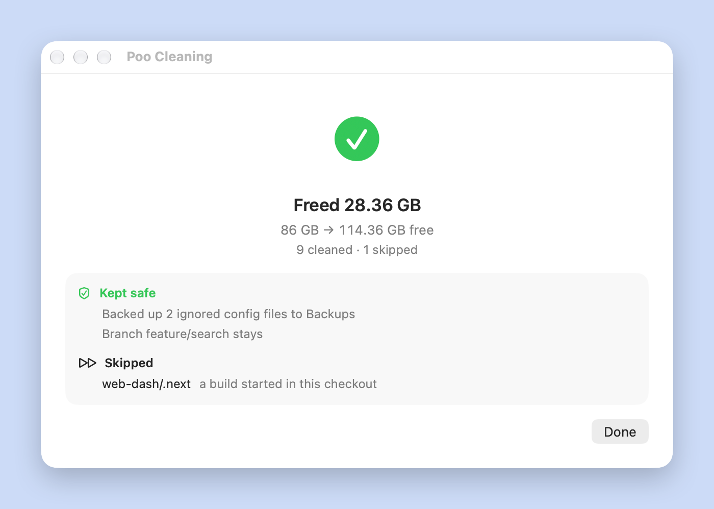
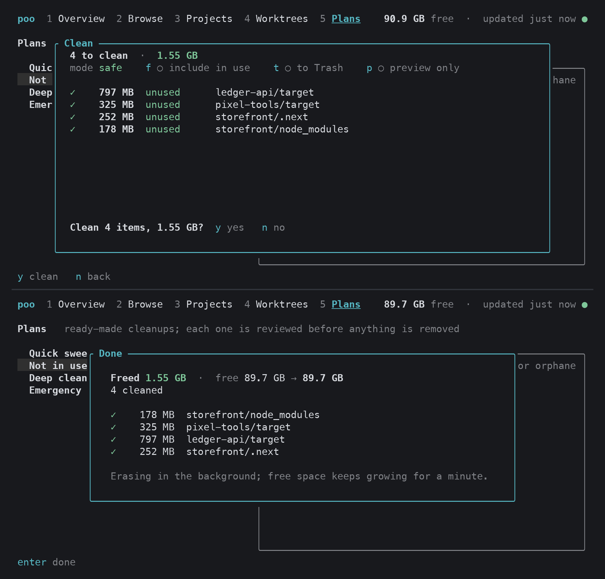

# poo

[](https://github.com/morajabi/poo/actions/workflows/ci.yml)
[](https://github.com/morajabi/poo/releases/latest)
[](#install)
[](LICENSE)

**Find and safely free the disk space your dev work eats.** A menu bar app and CLI for
macOS, plus an MCP server and skill so your coding agent can do it for you. Free and open
source. **[poo.morajabi.com](https://poo.morajabi.com)**

<p align="center">
  
</p>
<p align="center">
  
  
</p>

## Install

**App:** [download Poo.app](https://github.com/morajabi/poo/releases/latest/download/Poo.app.zip),
unzip it and move it to Applications. macOS 15 or later, Apple silicon or Intel. Signed
and notarized by Apple.

**CLI:**

```sh
curl -fsSL https://raw.githubusercontent.com/morajabi/poo/main/install.sh | sh
```

Installs `poo` into `~/.local/bin` (sha256-verified). Add `POO_APP=1` before `sh` to
install Poo.app too. Already have the app? Use **Poo › Install Command-Line Tool** instead:
it links the app's own CLI, which updates with the app. The CLI also runs on Linux.

<details>
<summary>Direct downloads</summary>

These links always point at the [latest release](https://github.com/morajabi/poo/releases/latest).

| | |
|---|---|
| Poo.app (universal, CLI included) | [Poo.app.zip](https://github.com/morajabi/poo/releases/latest/download/Poo.app.zip) |
| CLI, macOS Apple silicon | [poo-aarch64-apple-darwin.tar.gz](https://github.com/morajabi/poo/releases/latest/download/poo-aarch64-apple-darwin.tar.gz) |
| CLI, macOS Intel | [poo-x86_64-apple-darwin.tar.gz](https://github.com/morajabi/poo/releases/latest/download/poo-x86_64-apple-darwin.tar.gz) |
| CLI, Linux x86_64 | [poo-x86_64-unknown-linux-gnu.tar.gz](https://github.com/morajabi/poo/releases/latest/download/poo-x86_64-unknown-linux-gnu.tar.gz) |
| CLI, Linux arm64 | [poo-aarch64-unknown-linux-gnu.tar.gz](https://github.com/morajabi/poo/releases/latest/download/poo-aarch64-unknown-linux-gnu.tar.gz) |
| Checksums | [SHA256SUMS](https://github.com/morajabi/poo/releases/latest/download/SHA256SUMS) |

</details>

**Updates are automatic.** The app checks daily and installs updates through
[Sparkle](https://sparkle-project.org) when it's idle (or Poo › Check for Updates). The
script-installed CLI updates itself in the background once a day; `poo update` updates now,
and `poo config set updates.auto false` turns that into a one-line hint.

## Quick start

- **App:** open Poo. Setup takes about a minute: confirm the folders that hold your
  projects, optionally grant Full Disk Access, and choose whether to run nightly cleanups.
  Then press **Clean** in the menu bar, review the list, and confirm.
- **CLI:** run `poo setup` to pick your dev folders, then `poo` for the interactive view.
  Or step by step:

  ```sh
  poo plan stale              # preview what nothing is using
  poo clean --plan stale      # clean it, after you confirm
  ```

- **Agent:** run `poo integration install all`, then ask your agent to
  *"set up poo for me with `poo setup --agent`"*.

## Safety and privacy

- **Nothing is deleted until you review and confirm it**, or turn on a schedule or hook
  yourself. Plans never include anything running, anything that needs a look, or
  anything protected.
- **Worktrees are backed up before removal:** small ignored files (`.env`,
  `Local.xcconfig`) are copied aside, uncommitted work is stashed, and detached commits are
  saved to a branch. `poo backups` lists and restores them.
- **Full Disk Access is optional.** It is one switch in System Settings. Without it, poo
  skips the folders macOS guards and says so once, instead of prompting folder by folder.
- **No account, no telemetry.** The only network calls are update checks to GitHub, and
  [sharing a rule](#share-a-rule) when you ask for it.

Under the hood, poo never deletes outside your home and temp folders (or a rule's
declared system path), never deletes through a symlink, never touches `.ssh`, `.gnupg`,
Keychains or iCloud Drive, and never deletes a build folder that contains `.git`. Right
before deleting it re-checks each item against its rule and skips projects where a build or
coding agent is running. Worktrees are removed with `git worktree remove` and keep their
branch. Every clean is logged (`poo history`).

## What it finds

Most cleaners stop at global caches. On a developer Mac the real growth is elsewhere:

- every worktree (yours, Claude Code's, Codex's, Conductor's) gets its own Rust `target`,
  SwiftPM `.build`, Xcode DerivedData, `node_modules` and `dist`, duplicated per checkout;
- agents pass `-derivedDataPath` and `CARGO_TARGET_DIR` into folders nobody cleans;
- merged worktrees, old simulators and runtimes, superseded toolchains and agent CLI
  versions pile up.

poo walks your dev folders and agent worktree homes, maps DerivedData back to its checkout,
checks each worktree for uncommitted work and whether it landed, and labels every item by
how much regret cleaning it causes. It also covers the usual ground: app, browser and
system caches, logs, temp, installers, Docker and Homebrew.

| | |
|---|---|
|  |  |
|  |  |

## Features

### Tiers and plans

Every item gets a tier. Plans (`quick`, `stale` shown as "not in use", `deep`,
`emergency`) clean up to a tier, so you pick how much rebuilding you accept.

| tier | meaning | cleaned by plans |
|---|---|---|
| junk | nothing to rebuild: logs, temp, crash reports, broken simulators | quick, not in use, deep, emergency |
| cold | unused for days, orphaned (project gone), or its worktree's commits already landed | not in use, deep, emergency |
| idle | builds of checkouts other than your 2 newest per repo, untouched for hours | not in use, deep, emergency |
| warm | in active use: recent, or an agent, editor or shell is open in that checkout | deep, emergency |
| hot | a build or the owning app is running, or touched in the last hour | never |
| review | needs a human look: unknown ignored folders, worktrees with uncommitted work | never |
| protected | data, Docker volumes, projects you protected | never |

Mark projects `active`, `stale` or `protected` with `poo projects set`. Tune
`scan.keep_recent_checkouts` and `scan.idle_hours` to how many checkouts you build at once.
`--include-in-use` also cleans things in use (worktrees with uncommitted work are stashed
first); `--dangerously-include-protected` goes further and asks you to confirm.

### Routine cleanups

```sh
poo schedule add nightly    # 03:30 every night: clean what nothing is using
poo schedule add guard      # below 20 GB free, clean what is not in use until 50 GB are free
```

A launchd agent wakes poo every 15 minutes. Due schedules rescan first, notify you, and log
to `poo schedule log`.

### Agent hooks (opt-in)

`poo hooks install all` makes Claude Code and Codex clean a worktree's build output when an
agent finishes there and its work already landed in main. Nothing is installed by default.

### Fast, current numbers

The first scan walks everything (5 to 20 seconds with a warm disk cache). After that poo
keeps an index and reads the macOS file-change journal (FSEvents), so only folders that
changed are measured again. `poo scan --full` walks everything; `poo watch` keeps the
report live while the app is open.

## CLI

Run bare, `poo` opens an interactive terminal UI. Piped, every command prints JSON
(`--text` forces tables).

<p align="center">
  
  
</p>

```
poo                         interactive terminal UI (plain overview when piped or with --text)
poo scan [--full]           update the report (incremental unless --full)
poo ls [bucket] [--tier cold] [--project PATH] [--min 1G] [-q text]
poo show <id|path>          why it is there, what it costs to rebuild, what is inside
poo plan stale              preview a plan (quick, stale, deep, emergency)
poo clean <id>... | --plan stale [--dry-run] [--trash] [--yes]
poo free 30G                least-regret items until 30 GB are free
poo growth [--since 7d]     what grew, and when the disk fills at this rate
poo projects | poo worktrees
poo suggest                 big folders no rule explains yet, with draft rules
poo rules explain <path>    which rule matches and why
poo schedule | poo backups | poo history | poo update | poo doctor
```

<p align="center">
  
</p>

`poo --help` lists everything. Errors are `{"error":{"kind","message","hint"}}` with
stable exit codes: 2 usage, 3 not found, 5 needs approval, 6 partial failure, 7 update
failed, 8 invalid config or mods, 9 busy.

## For coding agents

```sh
poo integration install all                  # skill + MCP for Claude Code, Codex, Cursor, OpenCode, Gemini CLI, Windsurf, Claude desktop
npx skills add morajabi/poo --skill poo -g   # skill only, via the open skills CLI
```

The MCP server (`poo mcp`) gives agents tools to see the overview, list and inspect items,
preview plans, clean (dry run by default), explain paths and configure poo. Agents may
clean up to the tier you allow (`poo config set agents.auto_clean_max_tier cold`, the
default); anything above needs your approval.

`poo setup --agent` prints a brief with your disk, projects, duplication across worktrees
and the questions worth asking you, so an agent can tailor poo to your workflow.

## Configuration and mods

Settings live in `~/.config/poo/config.toml` (`poo config keys` lists them). Everything poo
knows is a built-in mod in the same TOML format you can write: about 650 rules and 96
project stacks, covering

- **Apple:** DerivedData (including custom `-derivedDataPath` folders), simulators and
  runtimes, device support, previews, SwiftPM, CocoaPods, Carthage, Tuist.
- **JS and Python:** npm, pnpm, Yarn, Bun, Deno, Next, Vite, Turbo, Nx, Expo, Playwright;
  pip, uv, Poetry, conda, pyenv, Jupyter, Hugging Face and torch models.
- **Systems and JVM:** Rust, Go, Zig, C/C++, Bazel, Nix, Gradle, Maven, Android SDK and
  emulators.
- **More:** Ruby, PHP, Elixir, Haskell, .NET, Flutter, embedded toolchains and more.
- **Infra:** Docker, OrbStack, Colima, Podman, Lima, UTM, Terraform and cloud CLIs.
- **AI:** worktrees and caches of Claude Code, Codex, Cursor, Conductor and other agent
  tools, plus Ollama, LM Studio and other local model stores.
- **macOS:** app, browser and Electron caches, logs, crash reports, installers, app
  leftovers and the Trash.

Generic folder names (`dist`, `build`, `out`, `vendor`) need proof they are build output,
so a committed folder never matches.
Add rules, override any field, disable rules, add buckets, or write providers and guards in
any language: see [docs/mods.md](docs/mods.md) or `poo mods docs`.

### Share a rule

Your Mac has folders ours never sees. `poo suggest` drafts a rule for each big folder no
rule explains; `poo mods submit <mod>` lints it, strips your paths and names, shows you
exactly what would be sent, and only then opens a pull request. See
[CONTRIBUTING.md](CONTRIBUTING.md).

## Development

```sh
cargo build --release          # CLI
./scripts/build-app.sh         # dist/Poo.app with the CLI bundled
```

- [CONTRIBUTING.md](CONTRIBUTING.md): rules, fixtures, checks and code layout.
- [docs/mods.md](docs/mods.md): the mod and rule format.
- [docs/releasing.md](docs/releasing.md): the release pipeline, signing and Sparkle keys.

Homebrew formula and cask are in progress (`packaging/homebrew`).

## License

[MIT](LICENSE)
